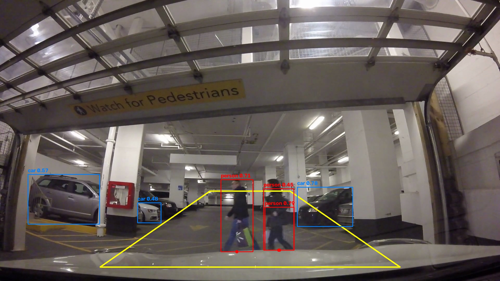
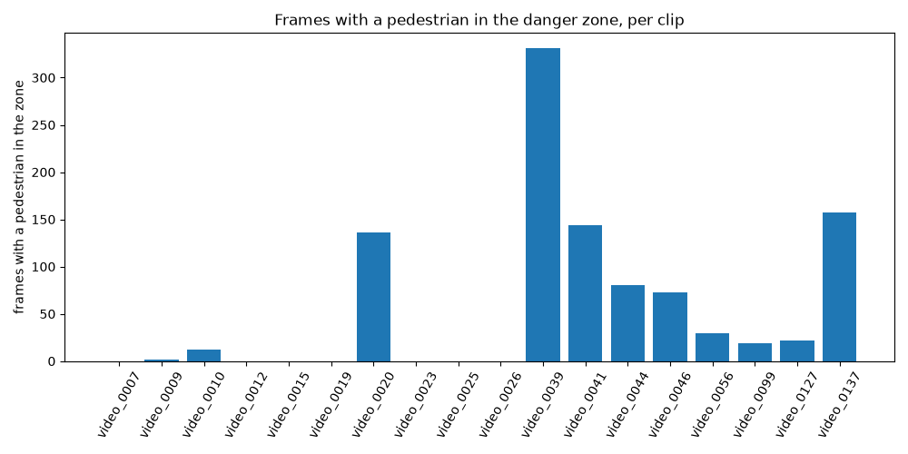
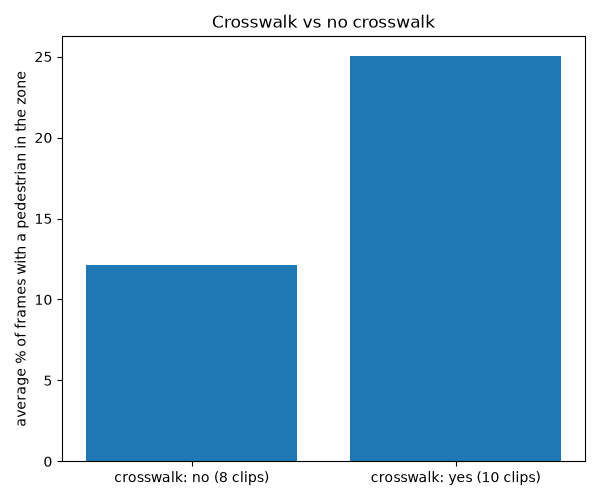

# Pedestrian Zone

How often, and for how long, pedestrians are in the road space right in front of a car, measured with a pretrained YOLO detector on dashcam clips from the JAAD dataset.

## Why I made this

[WRITE THIS YOURSELF: 4-6 sentences]

## What it does

1. Runs a pretrained YOLOv8n detector on each clip, frame by frame.
2. Keeps only six COCO classes: person, bicycle, car, motorcycle, bus and truck.
3. Saves every detection to `results/detections.csv` (clip, frame, class, confidence and box corners).
4. Draws a fixed "danger zone" trapezoid in the lower middle of the image, roughly the road space the car will drive into next. A pedestrian is in the zone when the bottom middle point of their box (their feet) is inside the trapezoid.
5. For each clip, works out how many frames have a pedestrian, how many frames have a pedestrian in the zone, how many seconds pass before the first pedestrian appears, and the tallest pedestrian box.
6. Joins these numbers with my own scene labels in `my_labels.csv` (crosswalk, signal, time of day, weather).
7. Makes three charts: frames in the zone per clip, crosswalk vs no crosswalk, and pedestrian box height over time for one clip.
8. Saves one annotated example video and one example frame.

Example frame (video_0002, frame 100). The yellow trapezoid is the danger zone. Red boxes are pedestrians with their feet inside the zone, green boxes are pedestrians outside it, and blue boxes are vehicles. The dot under each pedestrian box is the feet point.



## Data

The clips come from JAAD (Joint Attention in Autonomous Driving), made by Amir Rasouli, Iuliia Kotseruba and John K. Tsotsos at York University, Toronto. JAAD has 346 short clips filmed from inside a car, mostly in North America and Europe, with hand-made boxes and behaviour labels for pedestrians. The annotations and code are at https://github.com/ykotseruba/JAAD.

Licence: the JAAD video clips are licensed under the Creative Commons Attribution 4.0 International License, and the JAAD code is under the MIT License. The example frame in this README comes from JAAD clip video_0002.

The videos are not included in this repository. To get them:

1. Download `JAAD_clips.zip` (about 3.1 GB) from the link in the JAAD README. It is hosted on the York University server and on Google Drive.
2. Unzip it. The clips are named `video_0001.mp4` to `video_0346.mp4`.
3. Copy the clips you want into a folder called `videos/` inside this project.

Clips I used and why: [fill in: list the 15 to 20 clips and how you chose them]

## Setup

Use Python 3.11. PyTorch, which ultralytics needs, does not support newer versions such as 3.14 yet.

```
python3.11 -m venv .venv
source .venv/bin/activate
pip install -r requirements.txt
```

Put the clips in `videos/`. The first run downloads the YOLO weights file `yolov8n.pt` (about 6 MB) automatically.

## How to run

Run the scripts in this order:

```
python detect.py
python analyze.py
python make_video.py
```

- `detect.py` writes `results/detections.csv` (one row per detection) and `results/clips.csv` (frame count, fps, width and height of each clip). `MAX_CLIPS` at the top of the file limits how many clips are used, which is useful for a first test. Set it to 0 to use every clip in `videos/`.
- `analyze.py` writes `results/summary.csv` and the three charts as PNG files in `results/`. The crosswalk chart is only made once `my_labels.csv` has values in it.
- `make_video.py` writes `results/example_<clip>.mp4` with the boxes and the zone drawn on it, and saves one frame as `results/example_frame.jpg`. The clip and frame are set at the top of the file. The video is not committed because it is large.

Optional check against the JAAD hand labels:

```
python check_against_jaad.py
```

This needs the JAAD annotation files. Download `video_XXXX.xml` for the clips you want to check from the `annotations` folder of the JAAD GitHub repository and put them in a folder called `jaad_annotations/`. The script compares YOLO's person boxes with JAAD's pedestrian boxes and writes `results/jaad_check.csv` with how many JAAD pedestrians YOLO found and missed.

## How the danger zone works

The zone is a trapezoid. Its corners are set as fractions of the image width and height, so it scales to any video size. In image coordinates, y = 0 is the top of the image and y = 1 is the bottom.

| corner | x (fraction of width) | y (fraction of height) |
|---|---|---|
| top left | 0.42 | 0.68 |
| top right | 0.58 | 0.68 |
| bottom right | 0.80 | 0.95 |
| bottom left | 0.20 | 0.95 |

```
             0.42    0.58
       0.68   +--------+
             /          \
            /            \
       0.95 +--------------+
           0.20          0.80
```

The zone is narrow at the top and wide at the bottom because the road ahead looks narrower the further away it is (perspective). I placed it by looking at frames from the test clips: the top edge is a little below the horizon, and the bottom edge goes past the start of the car's hood.

To test if a point is inside, `point_in_zone` first checks that the point is between the top and bottom edges. Then it works out where the left and right edges are at that height, by moving along each slanted side in proportion to how far down the point is, and checks that the point is between them.

Why the feet point and not the box centre: the zone is a patch of road surface, and the feet are the part of a person that touches the road. The centre of the box is around the person's waist, which in the image is drawn above the road behind them. A tall person standing just in front of the zone could have their centre inside it, and a person standing in the zone could have their centre above it. The feet point gives the person's position on the ground.

I had to move the bottom edge down after the first test. With the bottom edge at 0.88, two people walking right in front of the car were counted as outside the zone. Their feet were hidden by the hood, so YOLO's box ended at the hood line, just below the old edge. The bottom edge is now 0.95.

## My scene labels

I watched each clip and filled in `my_labels.csv` by hand. The columns are:

| column | values | meaning |
|---|---|---|
| clip | e.g. video_0001 | the clip name, the same as the file name without `.mp4` |
| crosswalk | yes / no | whether there is a marked pedestrian crossing in the car's path during the clip |
| signal | yes / no | whether there is a traffic signal controlling the crossing or junction |
| time_of_day | day / night | |
| weather | clear / rain / snow | |
| note | short text | anything unusual, for example a turn, a parking lot or a person who stops |

How I decided each value: [WRITE THIS YOURSELF: for example what counted as a crosswalk, how you handled dusk or wet roads, and what you did when a clip was unclear]

## Results

`results/summary.csv` has one row per clip with these columns: frames, clip_seconds, ped_frames (frames with at least one pedestrian), zone_frames (frames with a pedestrian in the zone), zone_percent, zone_seconds, first_ped_seconds (time before the first pedestrian is seen), max_box_height (tallest pedestrian box in pixels) and my labels.

| clip | ped_frames | zone_frames | zone_percent | first_ped_seconds | max_box_height | crosswalk |
|---|---|---|---|---|---|---|
| [fill from summary.csv after running] | | | | | | |

Frames with a pedestrian in the danger zone, per clip:



Crosswalk vs no crosswalk (average percent of frames with a pedestrian in the zone). I used percent instead of frame counts because the clips have different lengths:



Tallest pedestrian box over time for one clip:


Check against JAAD hand labels: [fill from results/jaad_check.csv after running]

## What I noticed

[WRITE THIS YOURSELF after looking at the results]

## Limitations

- Pixel position is not real distance. There is no camera calibration, so "in the zone" means "in this part of the image", not "within a number of metres of the car".
- Box height depends on how tall the person is, not only on how close they are. A child close by and an adult further away can have the same box height.
- When a person is very close, the hood hides their feet, so the bottom of the box is the hood line and not their real feet.
- YOLO misses small, far away or partly hidden pedestrians, and does worse at night. It can also draw two boxes on one person, or one box around two people walking close together.
- The trapezoid is fixed. It is wrong on curves and turns, and it was placed using frames from one camera position. Clips filmed with the camera mounted differently would need a different zone.
- The sample is small (15 to 20 clips) and the scene labels are my own judgement.
- There is no tracking, so the same person is counted again in every frame they appear in. The tallest-box chart can also jump from one person to another.

## What I would do next

- Add tracking (for example ByteTrack) so each person is counted once and can be followed over time.
- Use camera calibration to turn image positions into real distances on the road.
- Use JAAD's behaviour labels to look at whether the pedestrian looked at the car before crossing.
- Compare the danger zone with where drivers actually look, using driver gaze data.

## References

Rasouli, A., Kotseruba, I. and Tsotsos, J. K. (2017). Are They Going to Cross? A Benchmark Dataset and Baseline for Pedestrian Crosswalk Behavior. Proceedings of the IEEE International Conference on Computer Vision Workshops (ICCVW), pages 206-213.

Rasouli, A., Kotseruba, I. and Tsotsos, J. K. (2018). It's Not All About Size: On the Role of Data Properties in Pedestrian Detection. ECCV Workshops. (The JAAD README asks for this one to be cited too.)

JAAD repository: https://github.com/ykotseruba/JAAD

Ultralytics YOLO documentation: https://docs.ultralytics.com
