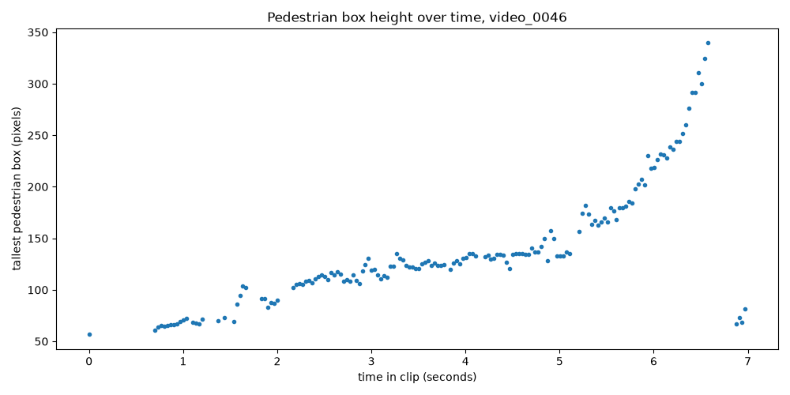

# Pedestrian Zone

How often, and for how long, pedestrians are in the road space right in front of a car, measured with a pretrained YOLO detector on dashcam clips from the JAAD dataset.

## Why I made this

I studied civil engineering at Ekiti State University in Nigeria, and during my internship I worked on the design of a 3 km highway. In road design, pedestrians mostly appear as numbers and standards: where crossings go, how wide walkways are, and how far a driver must be able to see. I wanted to look at the same road space from the driver's side and measure how often real pedestrians are actually in the path of a moving car. This project was my first step from road design into computer vision, using a pretrained detector and a public dataset instead of training my own model. It also showed me where a simple method stops working, which is the part I most want to learn more about in graduate study on pedestrian behaviour and driver attention.

## What it does

1. Runs a pretrained YOLOv8n detector on each clip, frame by frame.
2. Keeps only six COCO classes: person, bicycle, car, motorcycle, bus and truck.
3. Saves every detection to `results/detections.csv` (clip, frame, class, confidence and box corners).
4. Draws a fixed "danger zone" trapezoid in the lower middle of the image, roughly the road space the car will drive into next. A pedestrian is in the zone when the bottom middle point of their box (their feet) is inside the trapezoid.
5. For each clip, works out how many frames have a pedestrian, how many frames have a pedestrian in the zone, how many seconds pass before the first pedestrian appears, and the tallest pedestrian box.
6. Joins these numbers with my own scene labels in `my_labels.csv` (crosswalk, signal, time of day, weather).
7. Makes three charts: frames in the zone per clip, crosswalk vs no crosswalk, and pedestrian box height over time for one clip.
8. Saves one annotated example video and one example frame.

Example frame (video_0046, frame 94). A pedestrian is walking across a marked crosswalk ahead of the car. The yellow trapezoid is the danger zone. Red boxes are pedestrians with their feet inside the zone, green boxes are pedestrians outside it, and blue boxes are vehicles. The dot under each pedestrian box is the feet point.


## Data

The clips come from JAAD (Joint Attention in Autonomous Driving), made by Amir Rasouli, Iuliia Kotseruba and John K. Tsotsos at York University, Toronto. JAAD has 346 short clips filmed from inside a car, mostly in North America and Europe, with hand-made boxes and behaviour labels for pedestrians. The annotations and code are at https://github.com/ykotseruba/JAAD.

Licence: the JAAD video clips are licensed under the Creative Commons Attribution 4.0 International License, and the JAAD code is under the MIT License. The example frame in this README comes from JAAD clip video_0046.

The videos are not included in this repository. To get them:

1. Download `JAAD_clips.zip` (about 3.1 GB) from the link in the JAAD README. It is hosted on the York University server and on Google Drive.
2. Unzip it. The clips are named `video_0001.mp4` to `video_0346.mp4`.
3. Copy the clips you want into a folder called `videos/` inside this project.

### Clips I used and why

I used 18 clips: 9 where JAAD marks a pedestrian crossing in the scene and 9 where it does not, so the crosswalk comparison has the same number of clips on each side. JAAD's per-frame traffic annotations (`annotations_traffic/video_XXXX_traffic.xml`, the `ped_crossing` flag) were used only to choose the clips. The crosswalk values in `my_labels.csv` are my own, from watching each clip.

Rules for choosing:

1. Location is `street` and road type is `street` in JAAD. Parking lots, plazas and garages were left out, because the question is about pedestrians on roads.
2. JAAD has at least 30 frames with a labelled pedestrian, so there is something to detect.
3. Full HD (1920 x 1080), which covers 336 of the 346 clips.
4. In each group, I included the night, evening, rain and snow clips that were available, so the sample is not only clear daytime scenes.
5. The rest of each group was filled with the first clear or cloudy daytime clips in number order, so I did not pick clips by looking at the results.

| group (JAAD crossing flag) | clips |
|---|---|
| crossing | video_0015 (rain), video_0023 (night, rain), video_0025, video_0026 (night), video_0039 (60 fps, city centre), video_0041 (evening, 60 fps), video_0044, video_0046, video_0099 (rain, second camera) |
| no crossing | video_0007 (snow), video_0009, video_0010, video_0012, video_0019, video_0020, video_0056 (rain), video_0127 (second camera), video_0137 (rain, second camera) |

Notes on the clips:
- video_0099, video_0127 and video_0137 were filmed with a different car and camera. Part of the camera mount shows in the top right corner, and the windscreen wiper is visible.
- video_0039 and video_0041 are 59.94 fps. All the others are 29.97 or 30 fps.
- JAAD tags video_0127 as nighttime, but its frames are in daylight with snow on the ground.

## Setup

Use Python 3.11. PyTorch, which ultralytics needs, does not support newer versions such as 3.14 yet.

```
python3.11 -m venv .venv
source .venv/bin/activate
pip install -r requirements.txt
```

Put the clips in `videos/`. The first run downloads the YOLO weights file `yolov8n.pt` (about 6 MB) automatically.

## How to run

Run the scripts in this order:

```
python detect.py
python analyze.py
python make_video.py
```

- `detect.py` writes `results/detections.csv` (one row per detection) and `results/clips.csv` (frame count, fps, width and height of each clip). `MAX_CLIPS` at the top of the file limits how many clips are used, which is useful for a first test. Set it to 0 to use every clip in `videos/`.
- `analyze.py` writes `results/summary.csv` and the three charts as PNG files in `results/`. The crosswalk chart is only made once `my_labels.csv` has values in it.
- `make_video.py` writes `results/example_<clip>.mp4` with the boxes and the zone drawn on it, and saves one frame as `results/example_frame.jpg`. The clip and frame are set at the top of the file. The video is not committed because it is large.

Optional check against the JAAD hand labels:

```
python check_against_jaad.py
```

This needs the JAAD annotation files. Download `video_XXXX.xml` for the clips you want to check from the `annotations` folder of the JAAD GitHub repository and put them in a folder called `jaad_annotations/`. The script compares YOLO's person boxes with JAAD's pedestrian boxes and writes `results/jaad_check.csv` with how many JAAD pedestrians YOLO found and missed.

## How the danger zone works

The zone is a trapezoid. Its corners are set as fractions of the image width and height, so it scales to any video size. In image coordinates, y = 0 is the top of the image and y = 1 is the bottom.

| corner | x (fraction of width) | y (fraction of height) |
|---|---|---|
| top left | 0.42 | 0.68 |
| top right | 0.58 | 0.68 |
| bottom right | 0.80 | 0.95 |
| bottom left | 0.20 | 0.95 |

```
             0.42    0.58
       0.68   +--------+
             /          \
            /            \
       0.95 +--------------+
           0.20          0.80
```

The zone is narrow at the top and wide at the bottom because the road ahead looks narrower the further away it is (perspective). I placed it by looking at frames from the test clips: the top edge is a little below the horizon, and the bottom edge goes past the start of the car's hood. I then drew it on the middle frame of all 18 clips to check that it lies on the road in front of the car in each one, including the clips from the second camera.

To test if a point is inside, `point_in_zone` first checks that the point is between the top and bottom edges. Then it works out where the left and right edges are at that height, by moving along each slanted side in proportion to how far down the point is, and checks that the point is between them.

Why the feet point and not the box centre: the zone is a patch of road surface, and the feet are the part of a person that touches the road. The centre of the box is around the person's waist, which in the image is drawn above the road behind them. A tall person standing just in front of the zone could have their centre inside it, and a person standing in the zone could have their centre above it. The feet point gives the person's position on the ground.

I had to move the bottom edge down after the first test. With the bottom edge at 0.88, two people walking right in front of the car were counted as outside the zone. Their feet were hidden by the hood, so YOLO's box ended at the hood line, just below the old edge. The bottom edge is now 0.95.

## My scene labels

`my_labels.csv` has one row per clip. The values were decided by looking at frames from the start, one third, two thirds and the end of each clip, and at full size frames where something was too small to judge. JAAD's own tags were not copied into this file. The columns are:

| column | values | meaning |
|---|---|---|
| clip | e.g. video_0001 | the clip name, the same as the file name without `.mp4` |
| crosswalk | yes / no | whether there is a marked pedestrian crossing in the car's path during the clip |
| signal | yes / no | whether there is a traffic signal controlling the crossing or junction |
| time_of_day | day / night | |
| weather | clear / rain / snow | |
| note | short text | anything unusual, for example a turn, a parking lot or a person who stops |

How each value was decided:

- crosswalk: "yes" if a pedestrian crossing is marked on the road the car is driving on at any point in the clip, either by road paint (zebra stripes, crosswalk lines, yield triangles) or by a pedestrian crossing sign at the crossing point. People crossing mid-block where nothing is marked count as "no". Ontario pedestrian crossovers (overhead X sign) count as "yes".
- signal: "yes" only if there are red, amber and green traffic lights controlling the junction or crossing ahead. The flashing amber beacons over pedestrian crossovers and stop signs count as "no", because they do not tell the driver to stop on a red light.
- time_of_day: "night" if it is dark and the street lights are on. Low sun (video_0041) counts as "day".
- weather: "snow" if snow is falling or covers the road surface, not only the verges. "rain" if there are drops on the windscreen, the wipers are running, or the road is wet while it is raining. Otherwise "clear", which includes cloudy days.
- When something could not be seen clearly, the label follows what is visible and the note says so. For example, video_0041 is "no" because no markings could be seen on the wet road, even though JAAD marks a crossing there.

The crosswalk labels differ from JAAD's crossing flag on three clips: video_0012 (crosswalk lines at the junction at the end of the clip, which JAAD does not flag), video_0137 (a signed crossing by the traffic lights, which JAAD does not flag) and video_0041 (JAAD flags a crossing, but none could be seen in the frames). This is why there are 10 "yes" clips and 8 "no" clips, not 9 and 9.

## Results

These numbers come from running `detect.py` and `analyze.py` on the 18 clips above (5010 frames, 155 seconds of video). `detect.py` kept 19517 detections: 13468 car, 5446 person, 385 truck, 217 bus and 1 bicycle.

`results/summary.csv` has one row per clip with these columns: frames, clip_seconds, ped_frames (frames with at least one pedestrian), zone_frames (frames with a pedestrian in the zone), zone_percent, zone_seconds, first_ped_seconds (time before the first pedestrian is seen), max_box_height (tallest pedestrian box in pixels) and my labels.

| clip | seconds | ped_frames | zone_frames | zone_percent | zone_seconds | first_ped_seconds | max_box_height | JAAD crossing flag | crosswalk (my label) |
|---|---|---|---|---|---|---|---|---|---|
| video_0007 | 4.0 | 83 | 0 | 0.0 | 0.0 | 0.0 | 258 | no | no |
| video_0009 | 4.0 | 81 | 2 | 1.7 | 0.1 | 0.07 | 450 | no | no |
| video_0010 | 3.0 | 44 | 12 | 13.3 | 0.4 | 1.13 | 427 | no | no |
| video_0012 | 4.0 | 33 | 0 | 0.0 | 0.0 | 1.84 | 224 | no | yes |
| video_0015 | 14.0 | 104 | 0 | 0.0 | 0.0 | 0.97 | 150 | yes | yes |
| video_0019 | 16.0 | 262 | 0 | 0.0 | 0.0 | 0.0 | 133 | no | no |
| video_0020 | 18.0 | 515 | 136 | 25.2 | 4.5 | 0.0 | 657 (b) | no | no |
| video_0023 | 8.0 | 0 | 0 | 0.0 | 0.0 | none seen | 0 | yes | yes |
| video_0025 | 7.0 | 96 | 0 | 0.0 | 0.0 | 2.84 | 374 | yes | yes |
| video_0026 | 17.0 | 282 | 0 | 0.0 | 0.0 | 0.0 | 280 | yes | yes |
| video_0039 | 6.0 (a) | 360 | 331 | 91.9 | 5.5 | 0.0 | 414 | yes | yes |
| video_0041 | 6.0 (a) | 237 | 144 | 40.0 | 2.4 | 0.58 | 299 | yes | no |
| video_0044 | 7.0 | 168 | 80 | 38.1 | 2.7 | 1.4 | 342 | yes | yes |
| video_0046 | 7.0 | 161 | 73 | 34.8 | 2.4 | 0.0 | 340 | yes | yes |
| video_0056 | 9.0 | 241 | 29 | 10.7 | 1.0 | 0.0 | 338 | no | no |
| video_0099 | 6.0 | 59 | 19 | 10.6 | 0.6 | 0.0 | 935 (c) | yes | yes |
| video_0127 | 12.0 | 133 | 22 | 6.1 | 0.7 | 0.0 | 734 (c) | no | no |
| video_0137 | 7.0 | 182 | 157 | 74.8 | 5.2 | 0.3 | 683 (c) | no | yes |

(a) 59.94 fps, so these clips have about twice as many frames per second as the others. Compare clips using zone_percent or zone_seconds, not zone_frames.
(b) The tallest "person" boxes in video_0020 are on a large statue of human figures beside the road, not a real pedestrian.
(c) In the three clips from the second camera, YOLO sometimes marks the dark camera mount in the top right corner as a person (24 boxes in total, confidence 0.41 to 0.49). These boxes are never in the zone, so zone_frames is not affected, but max_box_height is. Without them the tallest boxes are 415 (video_0099), 247 (video_0127) and 464 (video_0137). The mount boxes also add 4 frames to ped_frames in video_0127.

A first_ped_seconds of 0.0 means a pedestrian was already visible in the first frame.

Frames with a pedestrian in the danger zone, per clip:


Crosswalk vs no crosswalk (average percent of frames with a pedestrian in the zone). I used percent instead of frame counts because the clips have different lengths. This chart is made from my own labels in `my_labels.csv`:


| crosswalk (my label) | clips | mean zone_percent | median zone_percent | clips with 0 zone frames | mean zone_seconds |
|---|---|---|---|---|---|
| no | 8 | 12.1 | 8.4 | 2 | 1.1 |
| yes | 10 | 25.0 | 5.3 | 5 | 1.6 |

The mean is higher for crosswalk clips, but the median is lower. Two clips (video_0039 at 91.9% and video_0137 at 74.8%) pull the crosswalk mean up, and half of the crosswalk clips have no frames with a pedestrian in the zone at all. With 8 and 10 clips, this is not a real difference, only a first look.

Tallest pedestrian box over time for video_0046. One pedestrian crosses the road ahead on a marked crosswalk. Their box grows from about 60 to 340 pixels as the car gets closer, then they leave the frame at about 6.6 seconds. The few low points after that are a different, smaller pedestrian further away. With no tracking, the chart cannot tell people apart.



### Check against JAAD hand labels

`check_against_jaad.py` was run on three clips chosen to be different from each other: a daytime crosswalk with one pedestrian (video_0046), a busy city centre crossing (video_0039) and a night clip in rain (video_0023). A JAAD pedestrian box counts as found when a YOLO person box overlaps it with an IoU of at least 0.5. Fully hidden pedestrians are left out.

| clip | scene | JAAD pedestrian boxes | found by YOLO | missed | missed % | missed, small (under 100 px tall) | missed, large |
|---|---|---|---|---|---|---|---|
| video_0046 | day, one pedestrian | 200 | 157 | 43 | 21.5 | 31 | yes |
| video_0039 | day, busy city crossing | 1762 | 865 | 897 | 50.9 | 469 | yes |
| video_0023 | night, rain | 394 | 0 | 394 | 100.0 | 232 | yes |

In video_0023, YOLO did not find any pedestrian at all. To check that this is not only caused by the 0.4 confidence limit, I ran YOLO on the same clip with a very low limit (0.05). Its highest person confidence in the whole clip was 0.36, and only 3 of the 240 frames had a person above 0.25. So the model does not see these pedestrians in the dark and rain, whatever the limit is.

More details of every test run are in [test_notes.md](test_notes.md).

## What I noticed

- Time with a pedestrian in the danger zone is spread very unevenly. Seven of the 18 clips have no frames with a pedestrian in the zone, while video_0039 (a busy city junction) has a pedestrian in the zone in 91.9% of its frames and video_0137 in 74.8%. A few busy scenes decide most of the totals.
- A crosswalk does not by itself mean pedestrians in front of the car. The crosswalk clips have a higher mean (25.0% against 12.1%) but a lower median (5.3% against 8.4%). Five crosswalk clips have no pedestrian in the zone at all. In video_0025, for example, a group walks across the marked crossing ahead. While they are in the middle of the road, their feet are at 0.64 to 0.67 of the image height, just above the top edge of the zone (0.68). By the time the car is closer, they have reached the left side of the road, outside the zone. Where the top edge is placed changes the result for clips like this.
- Pedestrians also end up in the zone where nothing is marked. In video_0009, video_0010 and video_0056, people cross mid-block, and all three have frames with a pedestrian in the zone. From a road design view, this is the case a crossing layout does not plan for.
- The two crossovers with an overhead X sign and flashing beacons (video_0044 and video_0046) each have a pedestrian in the zone for about 2.5 seconds, while the person walks across in front of the car. The video_0046 box height chart shows what that looks like: the pedestrian's box grows from about 60 to 340 pixels as the car gets closer.
- The three clips with traffic signals have the highest numbers (mean 55.6% against 12.0% without). But there are only three of them, and one is the busy junction in video_0039, so this mainly reflects how crowded those scenes are.
- The night results cannot be trusted. Both night clips show 0 frames in the zone. For video_0023 (night and rain), the JAAD check shows YOLO found none of the 394 labelled pedestrian boxes, so there "no pedestrian in the zone" means "the detector could not see", not "the road was empty".
- JAAD's own tags are not always right for this question: one clip is tagged nighttime but filmed in daylight, and the crossing flag disagrees with what is visible in three clips. Checking labels against the video mattered.

## Limitations

- Pixel position is not real distance. There is no camera calibration, so "in the zone" means "in this part of the image", not "within a number of metres of the car".
- Box height depends on how tall the person is, not only on how close they are. A child close by and an adult further away can have the same box height.
- When a person is very close, the hood hides their feet, so the bottom of the box is the hood line and not their real feet.
- YOLO misses small, far away or partly hidden pedestrians. In the JAAD check it missed 21.5% of pedestrian boxes in a quiet daytime clip and 50.9% in a busy city crossing. It can also draw two boxes on one person, or one box around two people walking close together.
- YOLO does much worse at night. In the night and rain clip (video_0023) it found none of the pedestrians JAAD labelled, so that clip shows 0 frames in the zone even though people are there. A clip with no detections is not the same as a clip with no pedestrians.
- YOLO also finds "people" that are not pedestrians: a statue of human figures (video_0020) and the camera mount in the corner of the second camera's clips. These inflate max_box_height for those clips. I did not filter them out, so that the code stays simple and the numbers show what the detector really did.
- The trapezoid is fixed. It is wrong on curves and turns, and it was placed using frames from one camera position. Clips filmed with the camera mounted differently would need a different zone.
- The sample is small (18 clips, 155 seconds of video) and the scene labels are my own judgement. A few clips with a lot of pedestrians in the zone (video_0039, video_0137) can move a group average a long way.
- Frame counts depend on frame rate. Two clips are 59.94 fps and the rest about 30 fps, so zone_frames is not comparable between them. zone_percent and zone_seconds are.
- There is no tracking, so the same person is counted again in every frame they appear in. The tallest-box chart can also jump from one person to another.

## What I would do next

- Add tracking (for example ByteTrack) so each person is counted once and can be followed over time.
- Use camera calibration to turn image positions into real distances on the road.
- Use JAAD's behaviour labels to look at whether the pedestrian looked at the car before crossing.
- Compare the danger zone with where drivers actually look, using driver gaze data.

## References

Rasouli, A., Kotseruba, I. and Tsotsos, J. K. (2017). Are They Going to Cross? A Benchmark Dataset and Baseline for Pedestrian Crosswalk Behavior. Proceedings of the IEEE International Conference on Computer Vision Workshops (ICCVW), pages 206-213.

Rasouli, A., Kotseruba, I. and Tsotsos, J. K. (2018). It's Not All About Size: On the Role of Data Properties in Pedestrian Detection. ECCV Workshops. (The JAAD README asks for this one to be cited too.)

JAAD repository: https://github.com/ykotseruba/JAAD

Ultralytics YOLO documentation: https://docs.ultralytics.com
